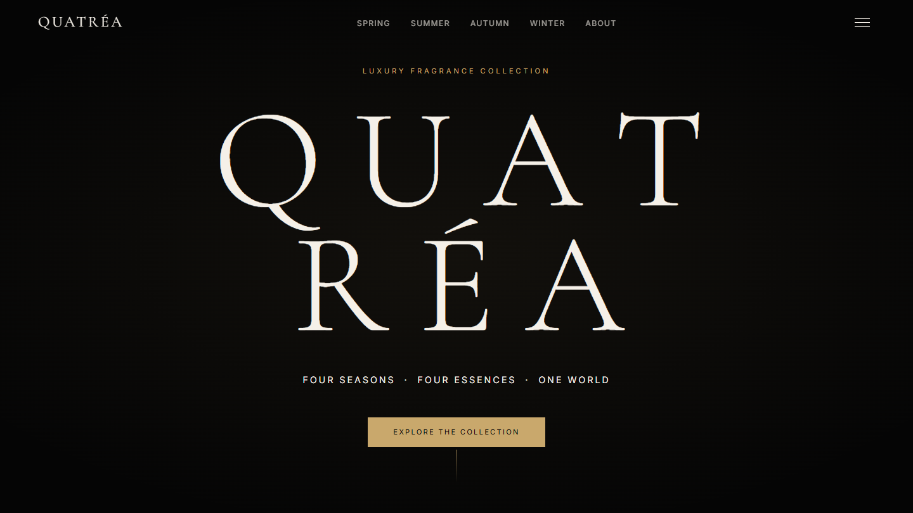
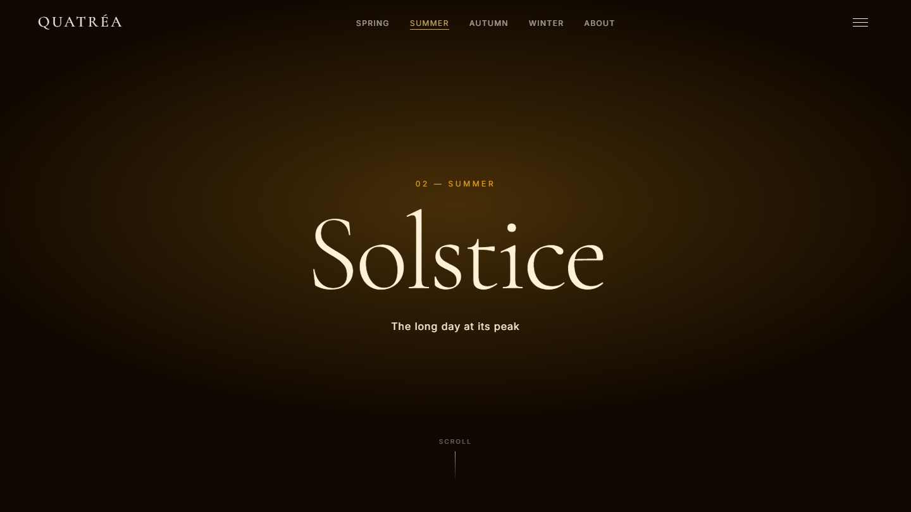
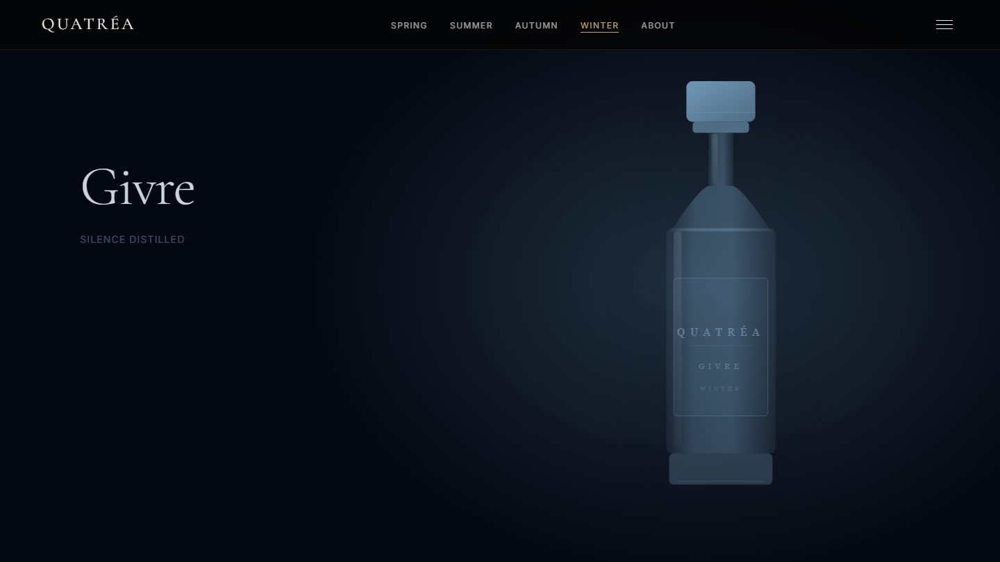

# Quatréa

A scrollytelling website concept for **Quatréa**, a fictional luxury perfume house with four fragrances, one for each season: **Floraison** (Spring), **Solstice** (Summer), **Crépuscule** (Autumn) and **Givre** (Winter).

**Live demo: [quatrea-lyart.vercel.app](https://quatrea-lyart.vercel.app)**



| Summer: Solstice | Winter: Givre (pinned bottle reveal) |
| --- | --- |
|  |  |

## Highlights

- **Six pages:** Home, one page per season (each with its own palette and fragrance story), and About.
- **Scroll-driven storytelling:** on every season page the bottle is pinned and revealed as you scroll, with notes, story and cross-season cards following.
- **Circular page transitions:** a new page grows from the point you clicked while the old one recedes and the navigation bar stays in place.
- **Smooth, quiet motion:** Lenis smooth scrolling, character-staggered hero, parallax, ambient grain, particles and a cursor glow, all tuned to feel slow and premium.
- **Works for everyone:** content is visible without JavaScript or with reduced motion, there is a skip link, a keyboard-friendly mobile menu and 44px touch targets.
- **Responsive:** checked at 390, 768 and 1440 px with no horizontal overflow.

## Stack

| Concern | Choice |
| --- | --- |
| Framework | Next.js 16 (App Router), React 19, TypeScript (`strict`) |
| Animation | GSAP 3 + ScrollTrigger |
| Smooth scroll | Lenis, driven by the GSAP ticker |
| Page transitions | View Transitions API, with a plain-navigation fallback |
| Styling | Hand-written CSS split by responsibility (`styles/`), Tailwind base only |
| Fonts | Cormorant Garamond (display), Inter (body) via `next/font` |

Runtime dependencies are limited to `next`, `react`, `react-dom`, `gsap` and `lenis`.

## Getting started

```bash
npm install
npm run dev        # http://localhost:3000
```

| Script | Purpose |
| --- | --- |
| `npm run dev` | Development server |
| `npm run build` | Production build (must pass before every push) |
| `npm run start` | Serve the production build |
| `npm run lint` | ESLint (Next.js core-web-vitals + TypeScript rules) |
| `npm run type-check` | `tsc --noEmit` |

Node 20.9 or newer is required; `.node-version` pins the version used in development.

## Project structure

```
app/                    Routes only: layout, metadata, one thin page per route
  layout.tsx            Fonts, motion guard script, skip link, global providers
  page.tsx              Home
  about/ spring/ summer/ autumn/ winter/
components/
  ambient/              Decorative layers: grain, cursor glow, particles, mesh, scroll progress
  layout/               Navigation, smooth scroll, route focus handling, page transitions
  ui/                   Reusable pieces: SeasonCard, PerfumeBottle, Divider, SimpleFooter
  home/ about/ season/  One folder per page: a *View, its sections, and motion.ts (the animation recipe)
content/                Copy and data: seasons, home, about, site
hooks/                  useMotion, useOffscreenPause
lib/                    Motion tokens, scroll singleton, transition bridge
styles/                 CSS by responsibility; globals.css imports them in order
docs/screenshots/       Images used in this README
```

Conventions:

- Pages are thin. Each `*View` composes sections; copy lives in `content/`, never in JSX.
- Each page's choreography lives in its own `motion.ts` and runs through `useMotion`.
- Season colours are data in `content/seasons.ts`; CSS derives every tint from `--season-accent`.

## Motion system

All durations, easings and distances come from `lib/motion.ts` (CSS twins are `--dur-*` and `--ease-*` in `styles/tokens.css`). The personality is deliberately slow, soft and minimal.

- **Tiers.** `useMotion` wraps `gsap.matchMedia`: desktop gets pinning and scrubbed storytelling, phones get simple one-shot reveals, and reduced motion gets no tweens. Preference changes while the page is open are followed live.
- **Content is visible by default.** Elements that animate in are hidden only while `<html>` has `.motion-ok`, set by a script before first paint. Without JavaScript, with reduced motion, or if the animation runtime fails to start within five seconds, everything is simply visible.
- **One writer per property.** GSAP owns `transform` and `opacity`; CSS hover effects use the individual `translate` property.
- **Ambient loops** (mesh, particles, marquee) pause while off screen, and no blur filter is applied to moving elements.

## Page transitions

Internal link clicks are wrapped in a view transition: the new page is revealed by a circle growing from the click point while the old one recedes, and the navigation bar stays continuous. The transition never gates navigation (a timeout guarantees completion), a pointer or key press skips it, and it is not used for back/forward, modified clicks, reduced motion or browsers without the API. After each navigation the scroll position resets and keyboard focus moves to `<main>`.

## Accessibility and responsiveness

- Skip link, visible focus styles, 44px minimum touch targets, and a mobile menu with Escape to close, inert page content and focus return.
- `prefers-reduced-motion`, `prefers-contrast`, `prefers-reduced-transparency` and forced-colors are handled in `styles/preferences.css`.
- Spring uses a darker accent for small text to meet 4.5:1 contrast.
- Layouts are verified at 390, 768 and 1440 px with no horizontal overflow.

## Deployment

Deployed on Vercel; no environment variables are required. Security headers (content type, framing, referrer, permissions, HSTS) are set in `next.config.ts`.

## Browser support

Everything works in current evergreen browsers. Circular page transitions need the View Transitions API (Chromium-based browsers and recent Safari); other browsers navigate normally.
